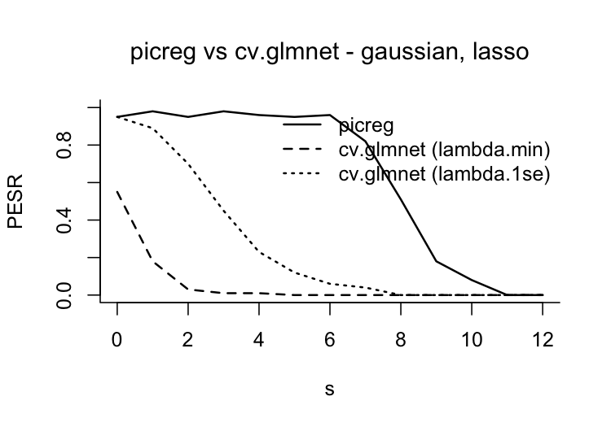

# picreg

<!-- badges: start -->
[](https://CRAN.R-project.org/package=picreg)
[](https://CRAN.R-project.org/package=picreg)
[](https://www.gnu.org/licenses/old-licenses/gpl-2.0.html)
[](https://vcmaxouuu.github.io/picreg/)
<!-- badges: end -->

**Tuning-free variable selection with the Pivotal Information Criterion.**

`picreg` fits sparse regression, classification and survival models with the
**Pivotal Information Criterion** (PIC) of
[Sardy, van Cutsem and van de Geer (2026)](https://arxiv.org/abs/2603.04172).
Like BIC or AIC, PIC fixes its penalty level *before* looking at the response.
Unlike them, it fixes it at the **detection boundary**: the smallest penalty
that keeps pure noise out of the model with probability $1 - \alpha$. This
penalty depends only on the design matrix, so PIC needs neither
cross-validation nor a grid of models, and it selects sparse, interpretable
models with a controlled number of false discoveries.

## Why PIC?

- **No tuning.** The regularization parameter is computed once from `X`,
  without cross-validation, validation set or path selection.
- **Calibrated false discoveries.** When the data carry no signal, PIC returns
  the empty model with probability $1 - \alpha$ (95% by default), for every
  family.
- **Sharp support recovery.** The probability of recovering exactly the true
  set of variables shows a phase transition, as in compressed sensing: close to
  one up to a critical sparsity level, then dropping.
- **Parsimony at no cost in prediction.** On benchmark datasets, PIC selects
  the smallest models among state-of-the-art selectors for a similar predictive
  performance ([see below](#performance)).
- **One interface, six models.** Gaussian, binomial, Poisson, exponential,
  Gumbel and Cox models, with the lasso, SCAD and MCP penalties, behind a
  `glmnet`-style API. The core is written in C++ (RcppArmadillo).

## Installation

Install the released version from CRAN:

```r
install.packages("picreg")
```

or the development version from GitHub:

```r
# install.packages("remotes")
remotes::install_github("VcMaxouuu/picreg")
```

## Quick start

`QuickStartExample` is a Gaussian dataset with $n = 100$ observations and
$p = 30$ predictors, of which only `gene_1`, ..., `gene_5` carry signal.

```r
library(picreg)

data(QuickStartExample)
X <- QuickStartExample$X
y <- QuickStartExample$y

fit <- pic(X, y, lambda_seed = 1)   # lambda_seed: reproducible calibration
summary(fit)
#> pic fit summary
#>   family    : gaussian
#>   penalty   : lasso
#>   lambda    : 0.3081
#>   dimensions: n = 100, p = 30
#>   selected  : 5 / 30
#>   intercept : 0.005989
#>
#>   Non-zero coefficients (original scale):
#>  variable coefficient
#>    gene_3     -0.7606
#>    gene_4     -0.6620
#>    gene_1     -0.4130
#>    gene_5      0.1495
#>    gene_2     -0.0571
```

The five active variables are recovered exactly, without any tuning. The fit
works with the usual methods:

```r
coef(fit)                              # sparse coefficients, original scale
predict(fit, newx = X[1:3, ])          # predictions on new data
plot(fit)                              # lollipop plot of the selected effects
assess(fit, newx = X, newy = y,        # predictive and support-recovery metrics
       true_features = paste0("gene_", 1:5))
```

Changing the model or the penalty only takes an argument; the calibration can
be reused across penalties, since it does not depend on them:

```r
fit_scad <- pic(X, y, penalty = "scad", lambda = fit$lambda_pdb)

data(BinomialExample)
fit_logit <- pic(BinomialExample$X, BinomialExample$y, family = "binomial")

data(CoxExample)
fit_cox <- pic(CoxExample$X, CoxExample$y, family = "cox")
```

## Supported models

| Model | `family =` | Response `y` | Loss minimized by PIC |
| --- | --- | --- | --- |
| Linear regression | `"gaussian"` | numeric | square root of the mean squared error (square-root lasso) |
| Logistic regression | `"binomial"` | 0/1, logical, or two-level factor | weighted score loss |
| Poisson regression | `"poisson"` | non-negative counts | weighted score loss |
| Exponential regression | `"exponential"` | non-negative | negative log-likelihood |
| Gumbel location-scale | `"gumbel"` | numeric | exponential of the negative log-likelihood, scale profiled out |
| Cox proportional hazards | `"cox"` | `(time, event)` matrix or `survival::Surv` | square root of the negative log partial likelihood (Breslow ties) |

Each model is combined with one of three penalties: `"lasso"` ($\ell_1$),
`"scad"` or `"mcp"`. The non-convex penalties reduce the shrinkage bias of the
lasso on large coefficients and recover the support at higher sparsity levels.

## How PIC chooses the penalty

PIC minimizes

$$
\phi\Bigl(l_n\bigl(g(\beta_0\mathbf{1} + X\boldsymbol\beta)\bigr)\Bigr)
+ \lambda_\alpha^{\mathrm{PDB}}\, \mathrm{pen}(\boldsymbol\beta),
$$

where $l_n$ is a base loss and $(\phi, g)$ are model-specific
transformations. The origin $\boldsymbol\beta = \mathbf 0$ is a solution as
soon as the penalty exceeds $\Lambda$, the sup-norm of the gradient of the
loss at the null fit. PIC sets the penalty at the **pivotal detection
boundary** $\lambda_\alpha^{\mathrm{PDB}}$, the $(1 - \alpha)$-quantile of
$\Lambda$ under pure noise. The transformations $(\phi, g)$ are chosen so
that this quantile does not depend on the unknown intercept or scale: it can be
computed from `X` alone, before the model is fitted.

`pic()` computes $\lambda_\alpha^{\mathrm{PDB}}$ with one of three methods,
through `lambda_method`:

| Method | Principle | When to use |
| --- | --- | --- |
| `"mc_exact"` (default) | Monte Carlo under the null model of the family | small to moderate problems |
| `"mc_gaussian"` | Monte Carlo under the Gaussian limit of the gradient | large $n$ |
| `"analytical"` | closed-form Bonferroni bound, conservative | very large problems |

```r
pdb_summary(fit)        # calibration details and simulated null distribution
plot(fit$lambda_pdb)    # null distribution with the selected lambda
```

## Performance

The results below are reported in
[Sardy, van Cutsem and van de Geer (2026)](https://arxiv.org/abs/2603.04172),
and the scripts that produce them are in [`simulations/`](https://github.com/VcMaxouuu/picreg/tree/main/simulations).

**Calibration under pure noise.** On Gaussian data with $n = p = 100$ and no
signal, PIC selected at least one variable in 4% of the datasets, for a target
of $\alpha = 5\%$. Cross-validated lasso (`cv.glmnet`, `lambda.min`) did so in
43% of the datasets, EBIC in 22% and BIC in 96%.

**Phase transition.** Probability of exact support recovery as a function of
the number $s$ of active variables (Gaussian model, $n = p = 100$,
non-zero coefficients of magnitude 3 with random signs, 100 replications per
$s$):

<p align="center">
  
</p>

**Real data.** Mean test performance (mean model size in parentheses) over 100
random 70/30 train-test splits (90 for Riboflavin), after an unpenalized refit
on the selected variables. BIC and EBIC use forward selection.

| Dataset | $n$ | $p$ | PIC (lasso) | PIC (SCAD) | cv.glmnet | BIC | EBIC |
| --- | ---: | ---: | --- | --- | --- | --- | --- |
| *Regression, relative test MSE* | | | | | | | |
| Prostate cancer | 97 | 8 | **0.435** (3.1) | 0.456 (2.7) | 0.451 (5.9) | 0.454 (3.1) | 0.460 (2.8) |
| Diabetes | 442 | 64 | 0.531 (4.6) | 0.535 (4.7) | 0.536 (17.6) | **0.529** (6.3) | 0.542 (4.7) |
| Riboflavin | 71 | 4088 | **0.411** (6.0) | **0.411** (6.0) | 1.323 (37.5) | 0.754 (40.0) | 0.492 (8.0) |
| *Classification, test accuracy* | | | | | | | |
| Breast cancer | 569 | 30 | **0.965** (4.5) | 0.950 (3.0) | 0.963 (12.9) | 0.962 (5.2) | 0.963 (4.3) |
| Ionosphere | 351 | 33 | 0.872 (4.6) | 0.867 (4.3) | **0.878** (17.5) | 0.867 (8.0) | 0.864 (6.0) |
| Sonar | 208 | 60 | 0.715 (4.0) | 0.720 (3.3) | **0.735** (19.8) | 0.729 (7.6) | 0.722 (4.4) |

On every dataset, a PIC fit selects the smallest model, with a predictive
performance close to the best one.

## Main functions

| Task | Functions |
| --- | --- |
| Fit a model | `pic()` |
| Inspect a fit | `summary()`, `coef()`, `plot()` |
| Predict and evaluate | `predict()`, `assess()` |
| Penalty calibration | `lambda_pdb()`, `pdb_summary()`, `plot(fit$lambda_pdb)` |
| Survival analysis | `predict(type = "survival")`, `feature_effects_on_survival()`, `plot_survival_curves()`, `plot_baseline()`, `concordance_index()` |
| Diagnostics | `phase_transition()`, `pdb_asymptotic()` |

## Documentation

- [Package website](https://vcmaxouuu.github.io/picreg/)
- [Get started](https://vcmaxouuu.github.io/picreg/articles/vignette.html): a
  walk-through of all six models, prediction, calibration and diagnostics
  (also available with `vignette("vignette", package = "picreg")`)
- [The PIC paradigm](https://vcmaxouuu.github.io/picreg/articles/pic-paradigm.html):
  the ideas behind the criterion
- [Function reference](https://vcmaxouuu.github.io/picreg/reference/index.html)

## Citation

If you use `picreg`, please cite:

> Sardy, S., van Cutsem, M. and van de Geer, S. (2026). The Pivotal
> Information Criterion. *arXiv:2603.04172*.
> <https://doi.org/10.48550/arXiv.2603.04172>

```bibtex
@article{sardy2026pic,
  title   = {The Pivotal Information Criterion},
  author  = {Sardy, Sylvain and van Cutsem, Maxime and van de Geer, Sara},
  journal = {arXiv preprint arXiv:2603.04172},
  year    = {2026},
  doi     = {10.48550/arXiv.2603.04172}
}
```

Related work:

- van Cutsem, M. and Sardy, S. (2026). Survival of the fittest Cox model: Pivotal
  variable selection for time-to-event data.
  [arXiv:2510.19374](https://arxiv.org/abs/2510.19374)
- van de Geer, S., Sardy, S. and van Cutsem, M. (2026). A pivotal transform for the
  high-dimensional location-scale model.
  [arXiv:2512.18705](https://arxiv.org/abs/2512.18705)

## Getting help

Bug reports and feature requests are welcome on the
[issue tracker](https://github.com/VcMaxouuu/picreg/issues).

## License

GPL-2. See the [GNU General Public License, version 2](https://www.gnu.org/licenses/old-licenses/gpl-2.0.html).
